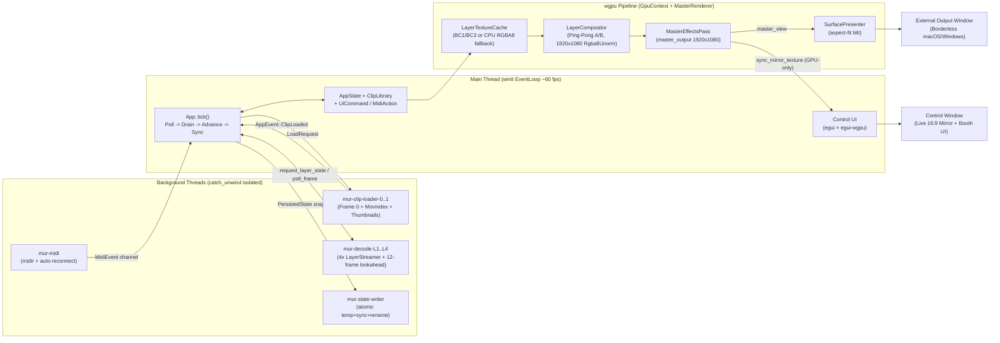

# MUR Developer Architecture

This document describes the internal architecture of **MUR**, grounded in the crate modules under [`src/`](../src/lib.rs).

---

## 1. High-Level System Diagram

---

## 2. Module Map

| Module | Responsibility | Key Types / Entry Points |
| --- | --- | --- |
| [`model`](../src/model/mod.rs) | Pure domain state, clamps, playhead math, blend & effect mappings | `AppState`, `LayerState`, `LayerIndex`, `ClipInfo`, `ClipKind`, `DecodedFrame`, `PixelPayload`, `BlendMode`, `MasterEffects` |
| [`error`](../src/error.rs) | Typed errors (`thiserror`) and bounded non-blocking toast/log buffers | `MurError`, `MediaError`, `MidiError`, `RenderError`, `ConfigError`, `ToastQueue`, `ToastNotification`, `LogEntry` |
| [`config`](../src/config.rs) | CLI parsing, OS paths, TOML/JSON project loading, atomic state persistence | `CliArgs`, `AppPaths`, `ProjectConfig`, `PersistedState`, `PersistedLayerState`, `StateSaver`, `save_state_atomic` |
| [`media`](../src/media/mod.rs) | Pure-Rust `.mov` parser, HAP decoder, PNG/JPEG loader, BC CPU fallback, 4 streaming workers | `MovIndex`, `decode_hap_frame`, `load_clip`, `load_image`, `decode_frame_to_rgba8`, `LayerStreamer`, `ClipAsset` |
| [`midi`](../src/midi/mod.rs) | Channel 1 Launch Control XL 3 parser & hot-plug `midir` background worker | `MidiAction`, `parse_midi_message`, `apply_midi_action`, `MidiWorkerHandle`, `choose_preferred_port` |
| [`render`](../src/render/mod.rs) | `wgpu` device/surface management, BC/RGBA texture cache, 4-layer compositor, master FX, presenter | `GpuContext`, `MasterRenderer`, `LayerTextureCache`, `LayerCompositor`, `MasterEffectsPass`, `SurfacePresenter` |
| [`platform`](../src/platform/mod.rs) | Monitor enumeration/matching, macOS/Windows borderless placement, native Quit guard | `MonitorDescriptor`, `find_matching_monitor`, `configure_output_window`, `install_exit_guard`, `macos`, `windows` |
| [`ui`](../src/ui/mod.rs) | `egui` booth layout, thumbnail texture cache, unified command protocol, keyboard fallback | `UiState`, `UiCommand`, `apply_ui_command`, `draw_control_ui_in`, `map_key_event`, `SHORTCUT_LEGEND` |
| [`app`](../src/app.rs) | `winit` event loop, ~60 fps tick orchestration, background pools, GPU & monitor recovery | `run`, `App`, `Runtime`, `ClipLibrary`, `ClipLoader`, `StateWriter`, `GpuStack`, `SurfaceSlot` |
| [`main`](../src/main.rs) | Binary entry point, `tracing` daily rolling log setup, panic backtrace hook | `main`, `init_logging`, `install_panic_hook` |

---

## 3. Pure-Rust Media & Streaming Pipeline

MUR avoids FFmpeg and external native codecs entirely. Every media format is validated and decoded in Rust crates (`snap` for Snappy, `image` for PNG/JPEG).

### Zero-Copy QuickTime `.mov` Parser (`src/media/mov.rs`)

- Walks top-level ISO-BMFF/QuickTime boxes via `Seek` without reading `mdat` payloads into memory (bounded by `MAX_TOP_LEVEL_BOXES = 100_000` and `MAX_MOOV_BYTES = 512 MiB`).
- Loads only the `moov` box and inspects `trak` children:
  - Non-video tracks (`hdlr` subtype != `vide`, e.g., audio and timecode) are ignored.
  - Sample descriptions (`stsd`) map `Hap1` → `ClipKind::Hap`, `Hap5` → `ClipKind::HapAlpha`, and `HapY` → `ClipKind::HapQ`. With several entries the first HAP entry is used (non-HAP entries such as previews are skipped), and every `stsc` run must reference that entry; a track mixing HAP with another codec is rejected. Unsupported variants (`HapM`, `HapA`, or other codecs) and compressed `cmov` headers return `MediaError::UnsupportedFormat`.
  - Builds a `Vec<MovSample>` (absolute `offset: u64` + `size: u32`) from `stsz`, `stsc`, and either `stco` (32-bit offsets) or `co64` (64-bit offsets), bounds-checked against file length and `MAX_SAMPLE_COUNT = 10_000_000` / `MAX_SAMPLE_BYTES = 256 MiB`.
  - Derives frame rate from `mdhd` timescale and `stts` durations, falling back to `FALLBACK_FPS = 60.0`.

### HAP Section & Snappy Decoder (`src/media/hap.rs`)

- Parses 4-byte (`u24 LE` + type) or 8-byte extended (`u32 LE` + type) HAP section headers.
- Validates the low nibble format against the expected `ClipKind` (`0x0B` DXT1, `0x0E` DXT5, `0x0F` YCoCg-DXT5) and rejects multi-image `0x0D` (`HapM`) frames.
- Handles all three high-nibble compression modes:
  - `0xA`: Uncompressed raw BC blocks.
  - `0xB`: Single Snappy stream validated with `snap::raw::decompress_len` before allocation.
  - `0xC`: Chunked/complex frames via the Decode Instructions container (`0x01`), reading the Compressor Table (`0x02`), Chunk Size Table (`0x03`), and optional Chunk Offset Table (`0x04`) up to `MAX_CHUNKS = 4096`.

### Frame-0 Residency & `LayerStreamer` (`src/media/mod.rs`, `src/media/streamer.rs`)

1. **Background Clip Loading (`ClipLoader`)**: Two worker threads (`mur-clip-loader-0..1`, wrapped in `catch_unwind`) parse the `.mov` index or PNG/JPEG image, decode **frame 0** into `ClipAsset::first_frame`, and generate an aspect-preserving RGBA8 thumbnail (max `192×108`) for the clip grid. Keeping frame 0 in RAM enables **0-frame trigger latency** when a clip is fired.
2. **Per-Layer Decode Workers (`LayerStreamer`)**: Spawns four dedicated threads (`mur-decode-L1`..`mur-decode-L4`).
   - **Non-blocking Render Contract**: On each frame tick, the main thread calls `request_layer_state` and `poll_frame`. `request_layer_state` updates a short mutex-protected `LayerControl` and deduplicates wakeups: when `clip_id`, clamped `desired_frame`, `speed`, `mode`, and `is_playing` are unchanged, it skips bumping `seq` and skips sending on the `bounded(1)` wake channel. `poll_frame` uses strict flat lock ordering (reading `control` and releasing it before locking `ring`), verifies `ring.generation == control.generation`, and never blocks on disk I/O or Snappy decoding; if the exact frame isn't decoded yet (temporary overload or skipped corrupt frame), it returns the nearest buffered frame of the current generation up to `MAX_SERVE_BEHIND = PREFETCH_AHEAD` frames behind or `MAX_SERVE_AHEAD = 1` frame ahead of the playhead (preferring frames just behind over ahead, so overload never skips into future content), or `None` so the renderer holds the previous GPU texture frame (`LayerUploadStatus::Held`). Calling `clear_layer` bumps `generation`, clears the target, and purges `FrameRing` immediately (`reset_ring`).
   - **Lookahead Ring Buffer**: `prefetch_window` computes the desired frame plus up to `PREFETCH_AHEAD = 12` future frames along the playback trajectory (`step = speed.abs() * clip_fps / RENDER_FPS`, where `RENDER_FPS = 60.0`), including both `floor(k * step)` and `ceil(k * step)` for fractional steps above `1.0`, wrapping via `rem_euclid` for `PlaybackMode::Loop` and stopping at clip boundaries for `PlaybackMode::OneShot`. `behind_frames` retains `RETAIN_BEHIND = 2` frames just behind the playhead to absorb tick jitter, stored in `FrameRing` of capacity `RING_CAPACITY = 16`.
   - **Generation Counters, Error Isolation & Bounded Shutdown**: Changing a layer's bound clip or clearing a layer increments `generation`, discarding stale decoded frames and reopening the file handle cleanly. Isolated per-frame `MediaError::Corrupt` / `MediaError::Decode` failures in multi-frame clips are skipped up to `MAX_CONSECUTIVE_FRAME_ERRORS = 8` consecutive failures (single-frame clips fail immediately), whereas `MediaError::Io` (e.g., deleted or truncated file) and `UnsupportedFormat` stop that layer's generation immediately (`failed_generation` + `LayerStreamEvent::Error`). Panics are caught by `supervise` (`catch_unwind`) and restarted with exponential backoff (`10 ms`..`1 s`), emitting `LayerStreamEvent::WorkerRestarted`. Dropping `LayerStreamer` signals `shutdown` on all workers and waits up to `SHUTDOWN_TIMEOUT = 2 s` via `Condvar` before detaching any worker still blocked in slow I/O so exit never hangs.

---

## 4. `wgpu` GPU Rendering Pipeline

All GPU rendering shares one `GpuContext` (`wgpu::Backends::PRIMARY`, `PowerPreference::HighPerformance`) and produces a single `1920×1080` `Rgba8Unorm` `master_output` texture per frame via `MasterRenderer`:

1. **Texture Upload & BC / YCoCg Handling (`src/render/texture_cache.rs`)**:
   - `LayerTextureCache` holds four `LayerTextureSlot`s. Uploads are deduplicated by `UploadKey` `(clip_id, frame_index, width, height, format, is_ycocg)` and validated against `max_texture_dimension_2d` and exact byte lengths before `queue.write_texture`.
   - When the adapter supports `wgpu::Features::TEXTURE_COMPRESSION_BC`, `Bc1` (`Bc1RgbaUnorm` + `force_opaque = 1`), `Bc3` (`Bc3RgbaUnorm`), and `Bc3YCoCg` (`Bc3RgbaUnorm` + `is_ycocg = 1`) payloads upload directly as compressed GPU textures (padded to 4×4 block boundaries, with `uv_max` cropping edge padding). HAP RGB carries no alpha, so `force_opaque` makes the shader ignore BC1's punch-through alpha (index 3 of three-color blocks is opaque black, never transparent).
   - On adapters without `TEXTURE_COMPRESSION_BC`, `plan_upload` falls back to `Rgba8Unorm` using `CpuFallbackDecoder` (`bc_decode::decode_frame_to_rgba8`), which converts BC1/BC3/BC3-YCoCg blocks to RGBA8 on CPU (BC1 is decoded fully opaque, matching the GPU path).

2. **4-Layer Ping-Pong Compositor (`src/render/compositor.rs`, `src/render/shaders/layer_composite.wgsl`)**:
   - Preallocates two `1920×1080` `Rgba8Unorm` targets (`target_a`, `target_b`) and per-layer uniform buffers so the render loop performs zero GPU buffer allocations.
   - Clears `target_a` to opaque black and draws active layers (`opacity > 0.0`) bottom-to-top (`L1` → `L4`), alternating read/write targets.
   - Inside `src/render/shaders/layer_composite.wgsl`:
     - Samples `src_tex` inside `src_rect` (computed by `fit_rect`) with half-texel UV clamping to avoid bleeding BC block padding.
     - Decodes `is_ycocg != 0` via `ycocg_to_rgb` (`scale = (b * 255/8) + 1`, `co`, `cg`, `y = a`).
     - Handles margins outside `src_rect`: opaque black (`alpha = opacity`) when `opaque_margin == 1` (`Hap`, `HapQ`, opaque images) or transparent (`alpha = 0.0`) when `opaque_margin == 0` (`HapAlpha`, alpha images). Margins are always composited with `Normal`, independent of the layer's blend mode, so an opaque clip's bars stay black under `Add` / `Screen` / `Difference` too.
     - Applies blend modes: `0` Normal, `1` Add, `2` Multiply, `3` Screen, `4` Difference.

3. **Single-Pass Master Effects (`src/render/effects.rs`, `src/render/shaders/master_effects.wgsl`)**:
   - Reads the final ping-pong composite and renders to `master_output` (`1920×1080` `Rgba8Unorm`).
   - Short-circuits to solid black on `blackout != 0`; otherwise applies `glitch` (14 Hz stepped row/block displacement + sweeping tear), `rgb_shift` (horizontal + radial channel offset), `brightness` / `contrast` / `saturation`, `strobe` (square-wave inversion at `strobe_speed_hz`), and `master_dimmer`. `time_secs` wraps every `3600.0 s` (`TIME_WRAP_SECS`).

4. **Dual Presentation & Zero-Readback Mirror (`src/render/presenter.rs`, `src/render/shaders/present.wgsl`, `src/app.rs`)**:
   - Output window is presented **first** (audience priority) via `SurfacePresenter::present`, which lazily caches pipelines per surface `TextureFormat`, fits `1920×1080` aspect-preserving into the monitor surface with black bars, and converts to linear space when `format.is_srgb()`.
   - Surface vsync split (`GpuContext::configure_surface_with_vsync`): Audience Output uses `prefer_vsync = true` (`OUTPUT_PREFERS_VSYNC = true`, preferring `Fifo` / `AutoVsync`), while the Control surface uses `prefer_vsync = false` (`CONTROL_PREFERS_VSYNC = false`, preferring non-blocking `Mailbox` / `Immediate` before falling back) so a slow control display never throttles the output frame.
   - Control window renders second via `egui_wgpu::Renderer`. `MasterRenderer::sync_mirror_texture` registers `master_view()` directly as an `egui::TextureId` so the booth mirror preview reads GPU memory with no CPU readback.
   - Frame rendering runs inside `App::render_frame_guarded` (`catch_unwind`) with a pre-`egui-wgpu` `stack.gpu.is_device_lost()` guard; while recovering, the control window title switches to `MUR — Control [GPU LOST — retrying...]` (`GPU_LOST_WINDOW_TITLE`).

---

## 5. Platform Integration & Resilience

### macOS & Windows Output Placement (`src/platform/{mod.rs,macos.rs,windows.rs}`)

- **Monitor Identification**: `MonitorDescriptor` builds stable IDs (`name|WxH|x,y`, plus `|cg:<id>` on macOS via `MonitorHandle::native_id()`). `find_matching_monitor_excluding` resolves saved/selected monitors by exact ID → matching `native_id` + name → exact name → case-insensitive name → stale ID matching name + position, skipping `exclude_id` (the control display) during name/position fallbacks so unplugging a same-model external display enters `WaitingForMonitor` instead of hijacking the control display. `pick_default_external_monitor` skips primary monitors so single-display systems never cover the booth UI.
- **macOS (`macos.rs`)**: Resolves each monitor's `NSScreen` by `CGDirectDisplayID` (`deviceDescription[@"NSScreenNumber"]`), reads `NSScreen::localizedName()` for display names, and detects the primary display from `NSScreen::screens().firstObject()`. Converts `winit` top-left physical coordinates into bottom-left AppKit logical points (`LogicalRect::flipped`), configures `NSWindow` with `setHidesOnDeactivate(false)`, `CanJoinAllSpaces | Stationary | IgnoresCycle | FullScreenAuxiliary`, `NSMainMenuWindowLevel + 1` (unless sharing the control monitor), and `orderFrontRegardless()` so keyboard focus remains on the control window. Holds an `AppNapGuard` (`AppNapActivity` using `NSProcessInfo` `UserInitiated | LatencyCritical | IdleDisplaySleepDisabled`) so macOS never throttles timers or the 60 fps run loop and keeps displays awake during MIDI-only sets.
- **Windows (`windows.rs`)**: Uses `winit` per-monitor DPI awareness (v2) with `Fullscreen::Borderless`, reading `MONITORINFOEXW` directly via `windows::monitor_info` (`GetMonitorInfoW`) to obtain device names and bounds safely without calling `MonitorHandle::name()` / `MonitorHandle::size()` (which panic on stale `HMONITOR` handles after unplug).

### Quit Guard

- **macOS**: `install_exit_guard` retargets all `terminate:` `NSMenuItem`s (up to depth 4) to a retained `MURQuitTarget` (`murRequestQuit:`) and attaches `applicationShouldTerminate:` onto winit's `WinitApplicationDelegate` class using `objc2::ffi::class_addMethod`, cancelling termination (including Dock Quit and OS logout/shutdown while running) and waking the event loop via `EventLoopProxy<AppEvent>` until `allow_termination()` is set on confirmed exit.
- **Windows / Cross-Platform**: `WindowEvent::CloseRequested` triggers `request_exit`, opening the modal `exit_confirm_open` guard in `egui`, which swallows all keys (including `Enter`, so live clip triggering cannot exit) except repeating a quit shortcut (`ConfirmExit`) and `Escape` (`CancelExit`).

### Fault Isolation & Code Safety Guardrails

- **Clippy Deny Rules (`Cargo.toml`)**: `unwrap_used`, `expect_used`, `panic`, `panic_in_result_fn`, `todo`, `unimplemented`, `unreachable`, and `indexing_slicing` are all set to `"deny"` across the crate.
- **Bounded Event Queues & Non-Blocking Render Loop**:
  - MIDI event draining is capped at `MAX_MIDI_EVENTS_PER_TICK = 512`.
  - `LayerStreamer` events use a bounded channel (`256`), and `ToastQueue` / `logs` are bounded ring buffers (`8` toasts, `200` logs).
  - `StateWriter` (`mur-state-writer`) runs `save_state_atomic` (`state.json.tmp-{pid}-{sequence}` → `write_all` → `sync_all` → `rename`) on a background thread, coalescing queued snapshots so disk `fsync` never stalls a 60 fps frame. `StateSaver` debounces dirty writes (`750 ms`). A `TempFileGuard` removes the temp file on any failed save, and quitting waits at most `STATE_WRITER_SHUTDOWN_TIMEOUT = 3 s` for the final flush (`thread_util::join_with_timeout`) before detaching a writer stuck in `fsync`.
- **Hardware & GPU Recovery**:
  - `MidiWorkerHandle` (`src/midi/worker.rs`) polls ports every `1000 ms`, drops vanished connections into `Reconnecting`, and supervises `midir` inside `catch_unwind` (`500 ms`..`8 s` backoff). The operator's port selection lives in a `PortSelection` shared with the supervisor, so a restarted worker reconnects to the latest `SelectPort` (including ones sent while it was down), and `Shutdown` interrupts the backoff. Dropping the handle joins the worker for at most `SHUTDOWN_TIMEOUT = 2 s` before detaching it. Auto-detect (`choose_preferred_port`) excludes `"DAW"` ports word-by-word (`is_daw_port`), prefers non-virtual `"MIDI"` ports matching Launch Control hints (`AUTO_DETECT_HINTS`), and never auto-connects to unknown third-party devices (which stay manually selectable). On macOS, `wait_for_command` pumps `CFRunLoopRunInMode` (`kCFRunLoopDefaultMode`) so CoreMIDI delivers hot-plug notifications.
  - `App::refresh_monitors` polls displays every `750 ms`; vanished monitors drop the output window cleanly into `WaitingForMonitor`. Control-window `Moved` events only re-enumerate when the window centre crosses onto another cached monitor rectangle (`platform::monitor_id_at`), so dragging the booth window stays smooth.
  - GPU `DeviceLost` or unrecoverable `SurfaceLost` (including panics caught by `render_frame_guarded` and pre-egui `is_device_lost()` checks) clears `GpuStack`, sets the control title to `MUR — Control [GPU LOST — retrying...]`, and retries creation every `2 s` (`GPU_RETRY_INTERVAL`) while keeping `AppState` and the clip library alive.

### Test Strategy

Unit tests live alongside each subsystem (`cargo test`) and end-to-end headless integration suites live under `tests/`:
- **Unit & Subsystem Tests (`src/**`)**:
  - Pure logic without a window server: `CliArgs`, `ProjectConfig`, `PersistedState` atomic round-trips, `MidiAction` parsing/clamping, `SHORTCUT_LEGEND` and `map_key_event` layout independence, `LayerState` playhead math, `ClipLibrary` async loading & pending bindings, and `LogicalRect` coordinate flipping.
  - Synthetic media & streaming: `src/media/test_fixtures.rs` generates valid and corrupt HAP `.mov` files in temporary directories to test `mov`, `hap`, `bc_decode`, `LayerStreamer` lookahead, and `inject_panic` supervisor recovery.
  - Headless GPU & UI tests: `render::tests` runs `MasterRenderer` on a headless `GpuContext` with `readback_master_rgba8` (skipping gracefully if no GPU adapter is available), and `ui::layout::tests` exercises `draw_control_ui` across empty, populated, overlay, and modal states via `egui::Context::run_pass`.
- **Media & Streamer Integration ([tests/media_hap_mov.rs](../tests/media_hap_mov.rs))**: Tests all three HAP codecs (`Hap`, `HapAlpha`, `HapQ`) across Uncompressed, Snappy, and Chunked variants, `co64` 64-bit offsets and ignored audio tracks, still-image alpha detection and `scan_media_dir` filtering/sorting, corrupt/truncated/garbage media rejection without panicking, four-layer streamer fault isolation when a file is truncated mid-playback, `Loop`/`OneShot`/retrigger sequencing, and resident `StaticImage` playback.
- **Headless GPU Pipeline & Performance Integration ([tests/gpu_pipeline.rs](../tests/gpu_pipeline.rs))**: Verifies real `wgpu` output (Metal on macOS) across all 5 blend modes, HAP Q `YCoCg` GPU conversion vs CPU fallback (`decode_frame_to_rgba8`), aspect-ratio margin opaqueness/transparency, master shader effects (`rgb_shift`, `glitch`, `strobe`, color grading, `master_dimmer`, `blackout`), `present_surface` 16:9-in-4:3 letterboxing, plus sustained multi-layer streaming benchmarks:
  - `four_layer_fhd_sustained_60fps_budget`: 180 frames @ `1920×1080` sustained 4-layer upload + composite benchmark asserting `< 16.67 ms` average frame time in release mode and `Uploaded` frames without `Held`. It renders back to back without a window, vsync, or the `WaitUntil` event loop, so it proves throughput headroom, not real-time 60 fps.
  - `four_layer_continuous_decode_streaming_240_frames`: 240 uncached `640×360` frames @ 60 fps verifying continuous background worker decode + GPU upload.
  - `soak_four_layer_sustained_with_midi`: `#[ignore]`d configurable 30-minute soak test (default `MUR_SOAK_SECS=1800`) exercising sustained 4-layer playback with MIDI actions (`cargo test --release --test gpu_pipeline -- --ignored`). Like the benchmark above it is a headless stability/throughput run.
  - **Real-time acceptance (SPEC §11)** is verified on the production machine with the real app: `PerfWindow` logs a `real-time performance` summary (target `perf`: average fps, dropped frames, worst tick interval) every `PERF_REPORT_INTERVAL = 60 s` and a session summary on exit, so the log of a 30-minute show run is the measurement record (see USAGE §8).
- **MIDI, Keyboard & State Integration ([tests/midi_and_state.rs](../tests/midi_and_state.rs))**: Tests Launch Control XL 3 Channel 1 CCs and Notes (including Notes `48`–`51` and ignoring non-Channel-1/malformed packets), full keyboard fallback (`map_key_event` + `apply_ui_command`), exit-guard key handling (`Enter` swallowed, `Escape` cancels, repeat quit key confirms, `egui_wants_keyboard` respected), TOML/JSON project relative-path resolution, and atomic `PersistedState` round-trips restoring on-air layers `Paused` (visible, frozen) and stopped layers `Stopped`.
