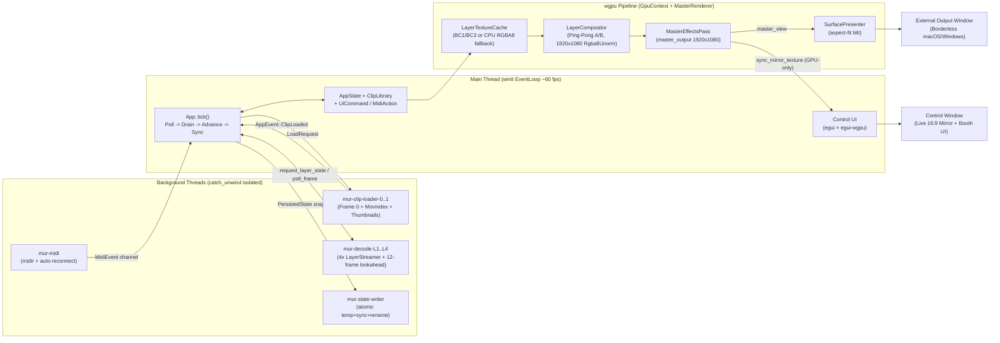

# MUR Developer Architecture

This document describes the internal architecture of **MUR**, grounded in the crate modules under [`src/`](../src/lib.rs).

---

## 1. High-Level System Diagram

---

## 2. Module Map

| Module | Responsibility | Key Types / Entry Points |
| --- | --- | --- |
| [`model`](../src/model/mod.rs) | Pure domain state, clamps, playhead math, blend & effect mappings | `AppState`, `LayerState`, `LayerIndex`, `ClipInfo`, `ClipKind`, `DecodedFrame`, `PixelPayload`, `BlendMode`, `MasterEffects` |
| [`error`](../src/error.rs) | Typed errors (`thiserror`) and bounded non-blocking toast/log buffers | `MurError`, `MediaError`, `MidiError`, `RenderError`, `ConfigError`, `ToastQueue`, `ToastNotification`, `LogEntry` |
| [`config`](../src/config.rs) | CLI parsing, OS paths, TOML/JSON project loading, atomic state persistence | `CliArgs`, `AppPaths`, `ProjectConfig`, `PersistedState`, `PersistedLayerState`, `StateSaver`, `save_state_atomic` |
| [`media`](../src/media/mod.rs) | Pure-Rust `.mov` parser, HAP decoder, PNG/JPEG loader, BC CPU fallback, 4 streaming workers | `MovIndex`, `decode_hap_frame`, `load_clip`, `load_image`, `decode_frame_to_rgba8`, `LayerStreamer`, `ClipAsset` |
| [`midi`](../src/midi/mod.rs) | Channel 1 Launch Control XL 3 parser & hot-plug `midir` background worker | `MidiAction`, `parse_midi_message`, `apply_midi_action`, `MidiWorkerHandle`, `choose_preferred_port` |
| [`render`](../src/render/mod.rs) | `wgpu` device/surface management, BC/RGBA texture cache, 4-layer compositor, master FX, presenter | `GpuContext`, `MasterRenderer`, `LayerTextureCache`, `LayerCompositor`, `MasterEffectsPass`, `SurfacePresenter` |
| [`platform`](../src/platform/mod.rs) | Monitor enumeration/matching, macOS/Windows borderless placement, native Quit guard | `MonitorDescriptor`, `find_matching_monitor`, `configure_output_window`, `install_exit_guard`, `macos`, `windows` |
| [`ui`](../src/ui/mod.rs) | `egui` booth layout, thumbnail texture cache, unified command protocol, keyboard fallback | `UiState`, `UiCommand`, `apply_ui_command`, `draw_control_ui_in`, `map_key_event`, `SHORTCUT_LEGEND` |
| [`app`](../src/app.rs) | `winit` event loop, ~60 fps tick orchestration, background pools, GPU & monitor recovery | `run`, `App`, `Runtime`, `ClipLibrary`, `ClipLoader`, `StateWriter`, `GpuStack`, `SurfaceSlot` |
| [`main`](../src/main.rs) | Binary entry point, `tracing` daily rolling log setup, panic backtrace hook | `main`, `init_logging`, `install_panic_hook` |

---

## 3. Pure-Rust Media & Streaming Pipeline

MUR avoids FFmpeg and external native codecs entirely. Every media format is validated and decoded in Rust crates (`snap` for Snappy, `image` for PNG/JPEG).

### Zero-Copy QuickTime `.mov` Parser (`src/media/mov.rs`)

- Walks top-level ISO-BMFF/QuickTime boxes via `Seek` without reading `mdat` payloads into memory (bounded by `MAX_TOP_LEVEL_BOXES = 100_000` and `MAX_MOOV_BYTES = 512 MiB`).
- Loads only the `moov` box and inspects `trak` children:
  - Non-video tracks (`hdlr` subtype != `vide`, e.g., audio and timecode) are ignored.
  - Sample descriptions (`stsd`) map `Hap1` → `ClipKind::Hap`, `Hap5` → `ClipKind::HapAlpha`, and `HapY` → `ClipKind::HapQ`. Unsupported variants (`HapM`, `HapA`, or other codecs) and compressed `cmov` headers return `MediaError::UnsupportedFormat`.
  - Builds a `Vec<MovSample>` (absolute `offset: u64` + `size: u32`) from `stsz`, `stsc`, and either `stco` (32-bit offsets) or `co64` (64-bit offsets), bounds-checked against file length and `MAX_SAMPLE_COUNT = 10_000_000` / `MAX_SAMPLE_BYTES = 256 MiB`.
  - Derives frame rate from `mdhd` timescale and `stts` durations, falling back to `FALLBACK_FPS = 60.0`.

### HAP Section & Snappy Decoder (`src/media/hap.rs`)

- Parses 4-byte (`u24 LE` + type) or 8-byte extended (`u32 LE` + type) HAP section headers.
- Validates the low nibble format against the expected `ClipKind` (`0x0B` DXT1, `0x0E` DXT5, `0x0F` YCoCg-DXT5) and rejects multi-image `0x0D` (`HapM`) frames.
- Handles all three high-nibble compression modes:
  - `0xA`: Uncompressed raw BC blocks.
  - `0xB`: Single Snappy stream validated with `snap::raw::decompress_len` before allocation.
  - `0xC`: Chunked/complex frames via the Decode Instructions container (`0x01`), reading the Compressor Table (`0x02`), Chunk Size Table (`0x03`), and optional Chunk Offset Table (`0x04`) up to `MAX_CHUNKS = 4096`.

### Frame-0 Residency & `LayerStreamer` (`src/media/mod.rs`, `src/media/streamer.rs`)

1. **Background Clip Loading (`ClipLoader`)**: Two worker threads (`mur-clip-loader-0..1`, wrapped in `catch_unwind`) parse the `.mov` index or PNG/JPEG image, decode **frame 0** into `ClipAsset::first_frame`, and generate an aspect-preserving RGBA8 thumbnail (max `192×108`) for the clip grid. Keeping frame 0 in RAM enables **0-frame trigger latency** when a clip is fired.
2. **Per-Layer Decode Workers (`LayerStreamer`)**: Spawns four dedicated threads (`mur-decode-L1`..`mur-decode-L4`).
   - **Non-blocking Render Contract**: On each frame tick, the main thread calls `request_layer_state` (updating a short mutex-protected `LayerControl` + sending on a `bounded(1)` wake channel) and `poll_frame`. `poll_frame` never blocks on disk I/O or Snappy decoding; if a frame isn't ready, it returns `None` and the renderer holds the previous GPU texture frame (`LayerUploadStatus::Held`).
   - **Lookahead Ring Buffer**: `prefetch_window` computes the desired frame plus up to `PREFETCH_AHEAD = 12` future frames in the playback direction (`speed.abs() * clip_fps / 60.0`), wrapping for `Loop` and clamping for `OneShot`, stored in a `FrameRing` of capacity `RING_CAPACITY = 16`.
   - **Generation Counters & Isolation**: Changing a layer's bound clip or clearing a layer increments `generation`, discarding stale decoded frames and reopening the file handle cleanly. I/O or decode errors set `failed_generation` and emit `LayerStreamEvent::Error` so only that layer stops. Panics are caught by `supervise` (`catch_unwind`) and restarted with exponential backoff (`10 ms`..`1 s`), emitting `LayerStreamEvent::WorkerRestarted`.

---

## 4. `wgpu` GPU Rendering Pipeline

All GPU rendering shares one `GpuContext` (`wgpu::Backends::PRIMARY`, `PowerPreference::HighPerformance`) and produces a single `1920×1080` `Rgba8Unorm` `master_output` texture per frame via `MasterRenderer`:

1. **Texture Upload & BC / YCoCg Handling (`src/render/texture_cache.rs`)**:
   - `LayerTextureCache` holds four `LayerTextureSlot`s. Uploads are deduplicated by `UploadKey` `(clip_id, frame_index, width, height, format, is_ycocg)` and validated against `max_texture_dimension_2d` and exact byte lengths before `queue.write_texture`.
   - When the adapter supports `wgpu::Features::TEXTURE_COMPRESSION_BC`, `Bc1` (`Bc1RgbaUnorm`), `Bc3` (`Bc3RgbaUnorm`), and `Bc3YCoCg` (`Bc3RgbaUnorm` + `is_ycocg = 1`) payloads upload directly as compressed GPU textures (padded to 4×4 block boundaries, with `uv_max` cropping edge padding).
   - On adapters without `TEXTURE_COMPRESSION_BC`, `plan_upload` falls back to `Rgba8Unorm` using `CpuFallbackDecoder` (`bc_decode::decode_frame_to_rgba8`), which converts BC1/BC3/BC3-YCoCg blocks to RGBA8 on CPU.

2. **4-Layer Ping-Pong Compositor (`src/render/compositor.rs`, `shaders/layer_composite.wgsl`)**:
   - Preallocates two `1920×1080` `Rgba8Unorm` targets (`target_a`, `target_b`) and per-layer uniform buffers so the render loop performs zero GPU buffer allocations.
   - Clears `target_a` to opaque black and draws active layers (`opacity > 0.0`) bottom-to-top (`L1` → `L4`), alternating read/write targets.
   - Inside `layer_composite.wgsl`:
     - Samples `src_tex` inside `src_rect` (computed by `fit_rect`) with half-texel UV clamping to avoid bleeding BC block padding.
     - Decodes `is_ycocg != 0` via `ycocg_to_rgb` (`scale = (b * 255/8) + 1`, `co`, `cg`, `y = a`).
     - Handles margins outside `src_rect`: opaque black (`alpha = opacity`) when `opaque_margin == 1` (`Hap`, `HapQ`, opaque images) or transparent (`alpha = 0.0`) when `opaque_margin == 0` (`HapAlpha`, alpha images).
     - Applies blend modes: `0` Normal, `1` Add, `2` Multiply, `3` Screen, `4` Difference.

3. **Single-Pass Master Effects (`src/render/effects.rs`, `shaders/master_effects.wgsl`)**:
   - Reads the final ping-pong composite and renders to `master_output` (`1920×1080` `Rgba8Unorm`).
   - Short-circuits to solid black on `blackout != 0`; otherwise applies `glitch` (14 Hz stepped row/block displacement + sweeping tear), `rgb_shift` (horizontal + radial channel offset), `brightness` / `contrast` / `saturation`, `strobe` (square-wave inversion at `strobe_speed_hz`), and `master_dimmer`. `time_secs` wraps every `3600.0 s` (`TIME_WRAP_SECS`).

4. **Dual Presentation & Zero-Readback Mirror (`src/render/presenter.rs`, `shaders/present.wgsl`, `src/app.rs`)**:
   - Output window is presented **first** (audience priority) via `SurfacePresenter::present`, which lazily caches pipelines per surface `TextureFormat`, fits `1920×1080` aspect-preserving into the monitor surface with black bars, and converts to linear space when `format.is_srgb()`.
   - Control window renders second via `egui_wgpu::Renderer`. `MasterRenderer::sync_mirror_texture` registers `master_view()` directly as an `egui::TextureId` so the booth mirror preview reads GPU memory with no CPU readback.

---

## 5. Platform Integration & Resilience

### macOS & Windows Output Placement (`src/platform/{mod.rs,macos.rs,windows.rs}`)

- **Monitor Identification**: `MonitorDescriptor` builds stable IDs (`name|WxH|x,y`). `find_matching_monitor` resolves saved/selected monitors by exact ID → exact name → case-insensitive name → stale ID matching name + position. `pick_default_external_monitor` skips primary monitors so single-display systems never cover the booth UI.
- **macOS (`macos.rs`)**: Converts `winit` top-left physical coordinates into bottom-left AppKit logical points (`LogicalRect::flipped`) to match the target `NSScreen` frame, configures `NSWindow` with `setHidesOnDeactivate(false)`, `CanJoinAllSpaces | Stationary | IgnoresCycle | FullScreenAuxiliary`, `NSMainMenuWindowLevel + 1` (unless sharing the control monitor), and `orderFrontRegardless()` so keyboard focus remains on the control window.
- **Windows (`windows.rs`)**: Uses `winit` per-monitor DPI awareness (v2) with `Fullscreen::Borderless`, verifying bounds via `GetMonitorInfoW`.

### Quit Guard

- **macOS**: `install_exit_guard` retargets all `terminate:` `NSMenuItem`s (up to depth 4) to a retained `MURQuitTarget` (`murRequestQuit:`) and attaches `applicationShouldTerminate:` onto winit's `WinitApplicationDelegate` class using `objc2::ffi::class_addMethod`, cancelling termination and waking the event loop via `EventLoopProxy<AppEvent>` until `allow_termination()` is set.
- **Windows / Cross-Platform**: `WindowEvent::CloseRequested` triggers `request_exit`, opening the modal `exit_confirm_open` guard in `egui`, which swallows all keys except `Enter` (`ConfirmExit`) and `Escape` (`CancelExit`).

### Fault Isolation & Code Safety Guardrails

- **Clippy Deny Rules (`Cargo.toml`)**: `unwrap_used`, `expect_used`, `panic`, `panic_in_result_fn`, `todo`, `unimplemented`, `unreachable`, and `indexing_slicing` are all set to `"deny"` across the crate.
- **Bounded Event Queues & Non-Blocking Render Loop**:
  - MIDI event draining is capped at `MAX_MIDI_EVENTS_PER_TICK = 512`.
  - `LayerStreamer` events use a bounded channel (`256`), and `ToastQueue` / `logs` are bounded ring buffers (`8` toasts, `200` logs).
  - `StateWriter` (`mur-state-writer`) runs `save_state_atomic` (`state.json.tmp` → `write_all` → `sync_all` → `rename`) on a background thread, coalescing queued snapshots so disk `fsync` never stalls a 60 fps frame. `StateSaver` debounces dirty writes (`750 ms`).
- **Hardware & GPU Recovery**:
  - `MidiWorkerHandle` polls ports every `1000 ms`, drops vanished connections into `Reconnecting`, and supervises `midir` inside `catch_unwind` (`500 ms`..`8 s` backoff).
  - `App::refresh_monitors` polls displays every `750 ms`; vanished monitors drop the output window cleanly into `WaitingForMonitor`.
  - GPU `DeviceLost` or unrecoverable `SurfaceLost` clears `GpuStack` and retries creation every `2 s` (`GPU_RETRY_INTERVAL`) while keeping `AppState` and the clip library alive.

### Test Strategy

Unit and headless integration tests live alongside each subsystem (`cargo test`), verifying:
- Pure logic without a window server: `CliArgs`, `ProjectConfig`, `PersistedState` atomic round-trips, `MidiAction` parsing/clamping, `SHORTCUT_LEGEND` and `map_key_event` layout independence, `LayerState` playhead math, `ClipLibrary` async loading & pending bindings, and `LogicalRect` coordinate flipping.
- Synthetic media & streaming: `src/media/test_fixtures.rs` generates valid and corrupt HAP `.mov` files in temporary directories to test `mov`, `hap`, `bc_decode`, `LayerStreamer` lookahead, and `inject_panic` supervisor recovery.
- Headless GPU & UI tests: `render::tests` runs `MasterRenderer` on a headless `GpuContext` with `readback_master_rgba8` (skipping gracefully if no GPU adapter is available), and `ui::layout::tests` exercises `draw_control_ui` across empty, populated, overlay, and modal states via `egui::Context::run_pass`.
